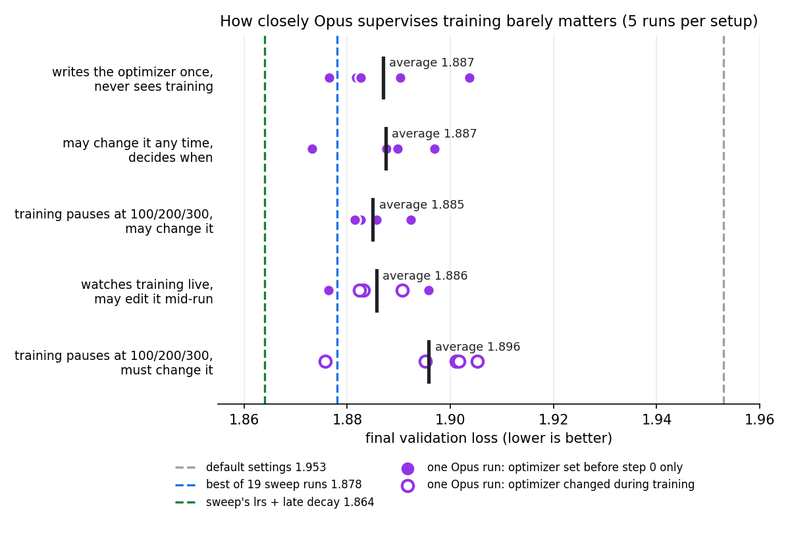
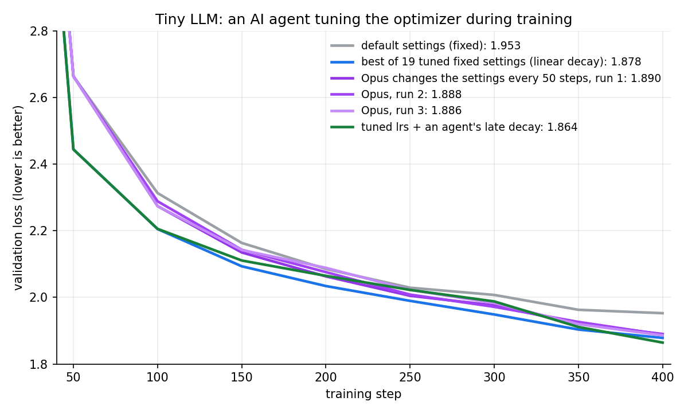

# Let an AI agent tune the optimizer while your LLM trains

<p>


</p>

## Abstract

**An AI agent (Claude Opus) improved the optimizer of a small language model while it trained.** It could not restart training or undo a change.

**In one training run, Opus got close to the best of 19 hand-tuned runs, every time.** It found a better learning-rate schedule than the sweep but missed the best learning rates.

**Watching training closely did not help.** Writing the optimizer once before training was as good as watching every step live. Forcing the agent to make changes made it a little worse.

This is a small version of [Reactive Optimizers (OPAL)](https://xingjianbai.com/reactive-optimizers/), the MIT paper where an agent rewrites the optimizer during training.

> [!IMPORTANT]
> Validation loss (how wrong the model's next-letter guesses are, lower is better): default settings **1.953**, Opus **1.885–1.896** on average in every setup, best of 19 tuned runs **1.878**, tuned learning rates + the agent's schedule **1.864**.

---

## How each run works

1. A tiny language model trains for 400 steps (about 9 seconds on a laptop). Every run starts from the same weights and sees the same data in the same order, so the default optimizer gives **1.9526** every time.
2. Opus gets a folder with the model, the data, the optimizer code and a training script, and is told to improve the training.
3. It may rewrite anything in the optimizer code. It may not touch the model, the data or the 400 steps, and it may not restart.
4. After step 400 we reload the final model with an untouched copy of the model code and recompute the validation loss. All 25 numbers matched what the agent reported.

> **Any difference between runs comes only from the agent's choices.**

## Supervising training closely does not help: the 4 setups without forced changes score the same

The five setups differ only in **when** Opus can change the optimizer. Each ran 5 times, one run at a time.

| setup | what Opus can do | average loss (5 runs) |
|---|---|---|
| writes once | edits the optimizer, then trains all 400 steps in one go | 1.887 |
| decides when | trains any number of steps at a time and may edit between calls | 1.887 |
| forced to look | like "decides when", plus training pauses at steps 100, 200, 300 | **1.885** |
| watches live | sees the loss every step while training runs; edits take over from the next step | 1.886 |
| forced to change | training stops at steps 100, 200, 300 until the optimizer code has changed | 1.896 |
| *best of 19 tuned runs, no agent* | | *1.878* |

The four setups that do not force a change are within 0.002 of each other. Run-to-run spread is about 0.008, so they are the same. Exact prompts are in [setups/PROMPTS.md](setups/PROMPTS.md).

> **Let Opus write the optimizer once before training. Watching training did not make it better here.**

## Do not force the agent to change things

Forced runs average **1.896**, about 0.01 worse than the rest. Most forced changes were made because the script required them, not because the loss showed a problem. This comparison was picked after seeing the data, so treat it as a lead.

## The agent rarely steps in by itself

**20 of 25 runs never changed the optimizer after step 0.** In "forced to look" it saw the loss three times per run and changed nothing in all 5 runs. Only 3 "watches live" runs changed it mid-training.

Almost every run made the same plan at step 0: about 2× higher learning rates, a short warmup, hold, then decay to 0 over the last 150–250 steps.

## Keep the learning rate high, then drop it fast at the end

That plan is close to the warmup-stable-decay schedule used to train large LLMs. With the default learning rates, a late drop improves the loss by **0.046**; a straight-line decay from the start improves it by only 0.006.

## The agent missed the biggest win: the embedding learning rate

The model has two learning rates: one for the hidden weight matrices (trained with **Muon**) and one for the **embedding table**, which turns each letter into a vector (trained with **Adam**).

The best setting raises the embedding learning rate **10×**. Most agent runs raised it 2–3×. The one run that measured it (it tried several step sizes on spare training batches) went to 5× and still ended at 1.891.

> **The sweep found better learning rates and the agent found a better schedule. Using both gave 1.864, the best result.**

---

## Use Opus only when one training run costs more than about 40 H100-seconds

| what you buy | cost | loss |
|---|---|---|
| 1 run, default settings | $0.0002 | 1.953 |
| 7 runs with random sweep settings | $0.0013 | 1.886 |
| 1 run with Opus | $0.45 | 1.888 |

One Opus run matches about 7 random runs. It pays off when one training run costs more than **$0.075**: about 1 hour on the laptop or **39 seconds on an H100**. Opus at API list price; details and `cost.png` in [RESULTS.md](RESULTS.md).

---

## Research task: find where the agent fails and fix it

Agents can change a model's optimizer while it trains, but they often miss the biggest gains or make changes that hurt.

Take an agent harness of your choice (Claude Code, Codex) and a small transformer LLM that trains in a few seconds. Let the agent change anything about the optimizer during training.

Find cases where the agent makes things worse or misses a clear improvement. Once you have reproduced the problem, identify likely root causes and try some ways to fix it, such as different prompts, more information in the logs, or fewer or more decisions.

Rerun your evals and see what works and what doesn't. Send your code, raw run logs, and a short write-up of what you tried and found (in a shared GitHub repo if possible). Use any models you have access to, and keep the total spend small.

---

## Conclusion

On a short, smooth training run, Opus makes one good plan at the start: higher learning rates and a late decay. Watching the run adds nothing, and forcing extra changes hurts. What it misses is the balance between the two learning rates, which a cheap sweep finds. Use the sweep for the learning rates and the agent's schedule on top.

## Where it stops working

> [!WARNING]
> One small model, 400 steps, losses that fell smoothly in every run. On long runs where something goes wrong mid-training (loss spikes), watching may matter more; we did not test that. 5 runs per setup can show differences of about 0.01, not smaller.

## Setup

Byte-level transformer on TinyShakespeare: 3 layers, width 64, RoPE, QK-norm, RMSNorm, SwiGLU, no biases. Muon on hidden matrices, Adam on the embedding and norm gains. 400 steps, batch 16, 64 tokens of context. Agent: Claude Opus 5.5 in Claude Code.

All numbers, per-run tables and what each run changed: [RESULTS.md](RESULTS.md). Raw logs and every optimizer version: `runs/<setup>_<n>/`.

```bash
bash setups/make.sh look /tmp/look_1     # fresh run folder for one setup (before, free, look, live, forced); give it to the agent
python3 setups/check.py look_1           # recompute the final loss from runs/look_1/ckpt.pt and list when the optimizer changed
python3 setups/chart.py                  # setups.png
python3 plot.py                          # curves.png
```
