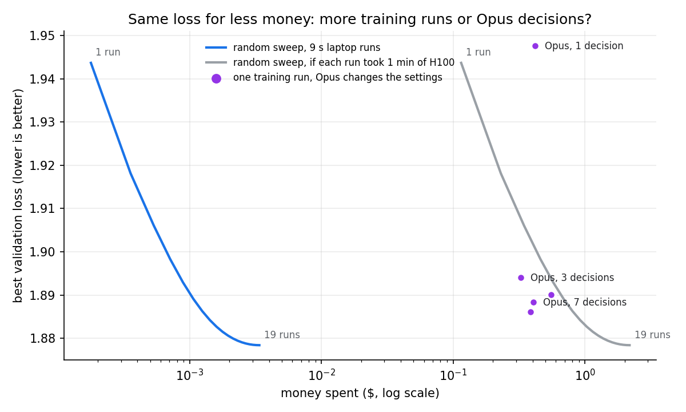

# Let an AI agent tune the optimizer while your LLM trains

## Abstract

**An AI agent (Claude) watched a language model train and changed the optimizer settings every 50 training steps.** It could not restart training or undo a change.

**In one run, the agent got close to the best of 19 hand-tuned runs.** Three repeated Claude Opus runs ended almost the same.

**The agent found a better learning-rate schedule than the sweep, but missed the best learning rates.** Putting the two together gave the best model.

This is a small version of [Reactive Optimizers (OPAL)](https://xingjianbai.com/reactive-optimizers/), the MIT paper where an agent rewrites the optimizer during training.

> [!IMPORTANT]
> Validation loss (how wrong the model's next-letter guesses are, lower is better): default settings **1.953**, Claude Opus **1.890 / 1.888 / 1.886** in 3 runs, best of 19 tuned runs **1.878**, tuned learning rates + the agent's schedule **1.864**.


---

## Training is repeatable, so differences come from the agent

Every run starts from the same weights and sees the same data in the same order. The default settings, run 3 times, gave **1.9526** every time.

> **Any difference between agent runs comes only from the agent's choices.**

## Opus gets close to a 19-run sweep in one run, every time

| who sets the optimizer | runs needed | final validation loss |
|---|---|---|
| nobody (default settings) | 1 | 1.953 |
| Claude Sonnet | 1 | 1.900 |
| Claude Opus, 3 separate runs | 1 each | 1.890, 1.888, 1.886 |
| best of 19 fixed settings (learning-rate sweep) | 19 | 1.878 |
| **sweep's learning rates + the agent's schedule** | 1 | **1.864** |

The 3 Opus runs ended within 0.004 of each other and closed **87%** of the gap between the default and the sweep. Sonnet closed 70%.

## Keep the learning rate high, then drop it fast at the end

Every agent run did the same thing: raise both learning rates early, hold them, then cut them over the last 150–200 steps. That is close to the warmup-stable-decay schedule used to train large LLMs.

With the default learning rates, this late drop improves the loss by **0.046**. A straight-line decay from the start improves it by only 0.006.

## The agent missed the biggest win: the embedding learning rate

The model has two learning rates: one for the hidden weight matrices (trained with **Muon**) and one for the **embedding table**, which turns each letter into a vector (trained with **Adam**).

The best setting needs the embedding learning rate **10x** the default. Every agent moved both learning rates together, so the embedding one only went up about 2x.

> **The sweep found better learning rates and the agents found a better schedule. Using both gave 1.864.**

---

## Use Opus only when one training run costs more than about 40 H100-seconds

We priced both sides:
- **Laptop:** a $2,000 MacBook used for 3 years, so one 9-second training run costs $0.00018.
- **Opus 5.5 at API list price:** $4 per million input tokens, $5 per million cache-write tokens, $0.20 per million cache-read tokens, $20 per million output tokens. We counted the tokens of every Opus run.

| what you buy | cost | final validation loss |
|---|---|---|
| 1 training run, default settings | $0.0002 | 1.953 |
| 7 training runs, settings picked at random from the sweep | $0.0013 | 1.886 (average) |
| 19 training runs (the whole sweep) | $0.0034 | 1.878 |
| 1 training run, Opus makes 1 decision (at step 200) | $0.42 | 1.948 |
| 1 training run, Opus makes 3 decisions | $0.33 | 1.894 |
| 1 training run, Opus makes 7 decisions (3 runs) | $0.45 (average) | 1.888 (average) |

One Opus run with 7 decisions reaches the same loss as about 7 random training runs, so it saves 6 runs. It is worth it when 6 runs cost more than Opus, which is when one run costs more than **$0.075**. That is about 1 hour on the laptop or **39 seconds on an H100** at $6.89 per hour.



> **On our laptop, one Opus run costs as much as about 2,500 training runs, so more runs win. For training runs longer than about 40 H100-seconds, Opus wins.**

Most of the Opus cost does not grow with the number of decisions. Half or more of it is writing the agent's starting instructions into the cache, which happens once per run. The 3-decision run was the cheapest because its cache write was smaller. All 5 Opus runs together would cost $2.09 at list price; we ran them on the $20 per month Claude plan.

`python3 cost.py` prints these numbers and draws the chart. Token counts are in `agent_tokens.jsonl`.

---

## Research task: find where the agent fails and fix it

Agents can change a model's optimizer while it trains, but they often miss the biggest gains or make changes that hurt.

Take an agent harness of your choice (Claude Code, Codex) and a small transformer LLM that trains in a few seconds. Let the agent change anything about the optimizer during training.

Find cases where the agent makes things worse or misses a clear improvement. Once you have reproduced the problem, identify likely root causes and try some ways to fix it, such as different prompts, more information in the logs, or fewer or more decisions.

Rerun your evals and see what works and what doesn't. Send your code, raw run logs, and a short write-up of what you tried and found (in a shared GitHub repo if possible). Use any models you have access to, and keep the total spend small.

---

## Where it stops working

> [!WARNING]
> One small model, 400 steps, 8 decisions per run. The agent could change only 4 numbers (two learning rates, momentum, weight decay); OPAL's agent rewrites the optimizer code and makes about 100 decisions. The agent saw only losses; it might find the learning-rate balance if it saw per-layer statistics.

## Setup

Byte-level transformer on TinyShakespeare: 3 layers, width 64, RoPE, QK-norm, RMSNorm, SwiGLU, no biases. Muon on hidden matrices, Adam on the embedding and norm gains. 400 steps, batch 16, 64 tokens of context, about 9 seconds per run on one CPU thread.

Short paper with all numbers: [paper.md](paper.md). Each agent's reasons for its changes: `runs/<name>/decisions.md`.

```bash
python3 train.py static --lr 0.02 --adam 0.03 --decay --decay_from 250   # one fixed run
python3 train.py reset --run NAME                                         # start an agent run in runs/NAME/
python3 train.py segment --run NAME                                       # train 50 steps with runs/NAME/config.json; the agent edits it between segments
python3 plot.py
```
